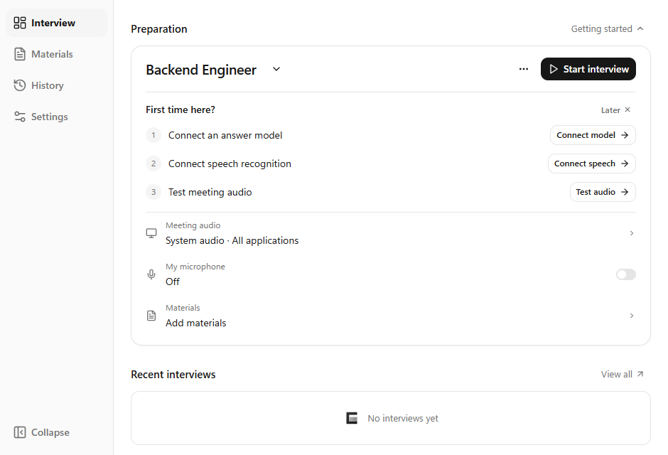

<p align="center">
  
</p>
<h1 align="center">Cuvilo</h1>
<p align="center"><strong>Hear the question. Shape your answer.</strong></p>
<p align="center">A Windows interview practice assistant · Live transcription · Screen questions · Personal materials</p>
<p align="center"><a href="README.md">简体中文</a> | <strong>English</strong></p>
<p align="center">
  <a href="https://github.com/Cuvilo/Cuvilo/releases/latest"></a>
  <a href="https://github.com/Cuvilo/Cuvilo/actions/workflows/release.yml"></a>
  <a href="LICENSE"></a>
</p>
<p align="center">
  <a href="https://github.com/Cuvilo/Cuvilo/releases/latest"><strong>Download for Windows</strong></a> ·
  <a href="docs/GETTING_STARTED.en.md">Getting started</a> ·
  <a href="docs/FAQ.en.md">FAQ</a> ·
  <a href="https://github.com/Cuvilo/Cuvilo/issues/new/choose">Report an issue</a>
</p>



## Download and install

Open the **[latest release](https://github.com/Cuvilo/Cuvilo/releases/latest)** and download the file ending in `x64-setup.exe`. Run it and follow the installer.

| File | Purpose |
| --- | --- |
| `Cuvilo_<version>_x64-setup.exe` | **Windows x64 installer. Download this to use Cuvilo.** |
| `.sig` and `latest.json` | Signature and metadata used by automatic updates. No manual download needed. |
| `Source code` | The tagged source snapshot for developers; not a runnable installer. |

Windows x64 is currently supported; Windows 11 is recommended. There are no native macOS, Linux or Windows ARM64 releases. **Windows 10 2004 (build 19041) and later are allowed to try per-application capture, subject to actual API activation.** Keep Windows updated. If activation fails, explicitly choose system audio. The published 0.1.51 release uses an overly strict version check; Windows 10 users can use system audio until the compatibility fix ships in the next release. See the [compatibility guide](docs/GETTING_STARTED.en.md#3-test-meeting-audio).

## Features

- **Live questions:** transcribe system or selected-application audio, with optional microphone context.
- **Reference answers:** generate streaming answers using personal background and relevant knowledge snippets. Ask manually, regenerate and copy individual code blocks.
- **Screen questions:** send a selected area to a vision model, with OCR and text-model fallback when vision is not configured or fails.
- **Personal materials:** import PDF, DOCX, UTF-8 TXT and Markdown. Keep personal experience separate from knowledge notes.
- **Review and export:** save transcripts and answers locally, review interviews, export Markdown and back up data.
- **Reading controls:** a separate answer window, light/dark/system themes, background transparency, font size and target answer length.
- **Interface language (next release):** follow the system, Simplified Chinese or English under Settings > Preferences. Changing the interface language preserves transcripts, model responses and personal materials in their original language.

## First-time setup

1. **Connect an answer model.** Open Getting started on the home page, enter your own API Key, test and save.
2. **Connect speech recognition.** Select a service, enter its credentials, test and save.
3. **Test meeting audio.** Play some audio, select an audio source, test it, then start an interview.

Import a resume or notes under Materials if you want answers to use your background. Follow the illustrated [getting started guide](docs/GETTING_STARTED.en.md).

Cuvilo does not provide model or speech credits. Third-party access, regions, pricing and quotas are controlled by each provider.

## Data and privacy

Text records, materials and settings are stored locally. Service credentials are stored in Windows Credential Manager. Cloud speech, models, vision and OCR receive the audio, text, material snippets or images needed for the selected action. Raw recordings are not saved by default. Knowledge materials use local keyword retrieval without downloading an embedding model.

Read the [data and privacy guide](docs/PRIVACY.en.md). Remove credentials and personal information before posting public feedback.

## Help

- [FAQ and troubleshooting](docs/FAQ.en.md)
- [Bug reports and feature requests](https://github.com/Cuvilo/Cuvilo/issues/new/choose)
- [Changelog (Chinese)](CHANGELOG.md)
- [Security reporting](SECURITY.md)

## Development

Built with Tauri 2, Rust, React, TypeScript, shadcn/ui and SQLite. Development requires Windows x64, Node.js, Rust MSVC, Visual Studio C++ build tools and WebView2.

```powershell
cd desktop
npm ci
npm run tauri dev
```

[Development notes](desktop/README.md) · [Contributing](CONTRIBUTING.md) · [Validation](desktop/VALIDATION.md) · [Releasing](RELEASING.md)

## License

Copyright (C) 2026 Cuvilo contributors.

Licensed under the **GNU General Public License version 3 only (GPL-3.0-only)**. See [LICENSE](LICENSE). Third-party dependencies retain their own copyright and license notices, including [shadcn/ui](desktop/public/licenses/shadcn-ui.txt).
