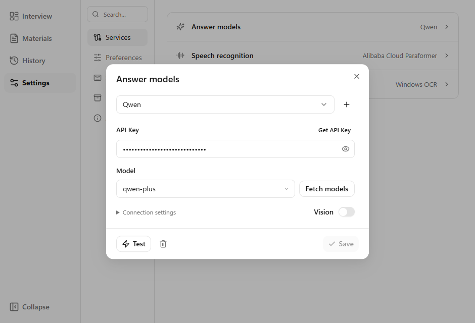
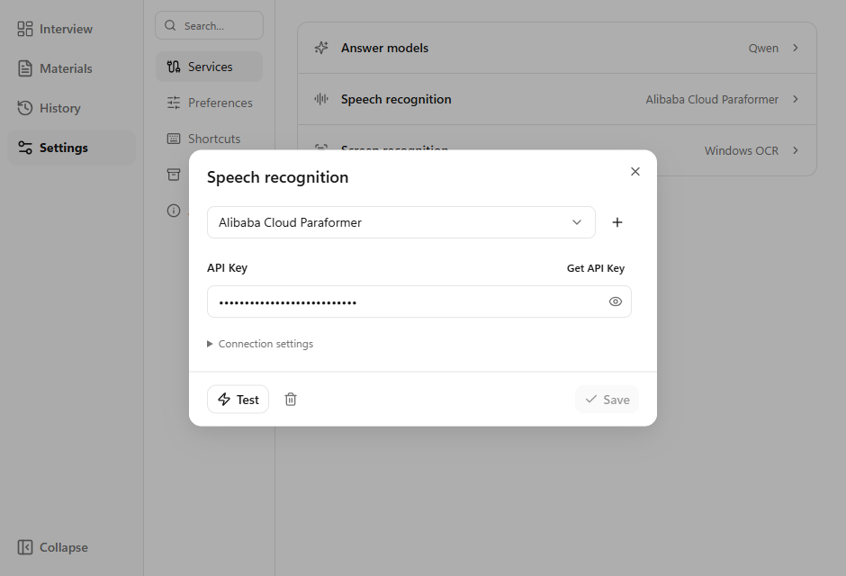

# Getting started

[简体中文](GETTING_STARTED.md) | **English** · [Home](../README.en.md) · [FAQ](FAQ.en.md) · [Privacy](PRIVACY.en.md)

## 1. Install Cuvilo

Download `Cuvilo_<version>_x64-setup.exe` from the [latest release](https://github.com/Cuvilo/Cuvilo/releases/latest). Install and open it. `.sig` and `latest.json` are for automatic updates.

Use Windows x64; Windows 11 is recommended. If WebView2 is missing, install the [Microsoft Evergreen Runtime](https://developer.microsoft.com/microsoft-edge/webview2/). Local OCR needs an installed Windows OCR language component; Cuvilo does not bundle those system components.

## 2. Connect your services

Open **Getting started** beside Preparation on the home page. Existing services can also be managed under Settings > Services.

1. Choose an answer-model provider, or add a Compatible API service for a Chat Completions-compatible endpoint.
2. Use Get API Key to open the provider's official console. Paste your own key.
3. Select a model, fetch the model list or enter its exact identifier. Check the Base URL under Connection settings.
4. Test the current input, then save.
5. Connect a speech recognition service in the same way. Required credentials depend on the service. OpenAI speech uses segmented Audio Transcriptions requests; realtime services use provider-specific protocols.

Only one answer model can have **Vision** enabled. Use a model that supports image input. When vision is unavailable or fails, the selected OCR service extracts text for the answer model.

## 3. Test meeting audio

1. Open Meeting audio on the home page.
2. Choose system audio or, on a supported Windows version, an application that is playing audio.
3. Play test audio and select Test audio. Enable My microphone only if you want your own speech included.
4. Start the interview and read answers in the separate window.

**Windows 10:** version 2004 (build 19041) and later can attempt application-specific capture. This is subject to actual API activation, system updates and the target application. If it fails, explicitly choose system audio and silence unrelated apps. The published 0.1.51 release uses an overly strict build cutoff; the source fix will ship in the next release. See the [OBS compatibility guide](https://obsproject.com/kb/application-audio-capture-guide).

System audio includes all applications playing sound on the captured output device. An application may appear in the source list only after it starts playing audio.

## 4. Add your materials

- **My experience:** your resume and confirmed project experience. Check extracted content before saving.
- **Knowledge:** notes and practice questions, retrieved locally by keywords to supply relevant snippets.
- Import PDF, DOCX, UTF-8 TXT or Markdown, drag files in, or create a text material. Files imported while Knowledge is selected keep that category.
- Image-only PDFs may need OCR before import. Enable only materials relevant to the interview.

## 5. Read and ask questions

| Action | Default shortcut |
| --- | --- |
| Screen question | `Ctrl+Shift+S` |
| Ask manually | `Ctrl+Shift+M` |
| Answer now | `Ctrl+Enter` |
| Stop generating | `Ctrl+Shift+X` |
| Show/hide answer window | `Ctrl+Shift+H` |

Change shortcuts under Settings > Shortcuts. Each code block has a copy button. The answer menu provides font size, target answer length and 0-80% background transparency. Target length is a model instruction rather than an exact guarantee.

## 6. Change interface language

This option ships in the next release; the currently published 0.1.51 installer does not include it yet.

Open **Settings > Preferences > Language**. Choose Follow system, 简体中文 or English. The interface updates immediately and saves the preference. Both app windows and the tray follow the setting. Your questions, transcripts, material content and model responses keep their original language.

## 7. Update and back up

Use the title-bar update button, Settings > About, or the new version in the tray menu. Updates are deferred during interviews. Save or close unsaved work before installing.

Create backups under Settings > Data. They include materials and text interview records, but not service settings or credentials. Restoring replaces materials and interview records after first creating a recovery backup. Configure your services again when moving to another computer.
