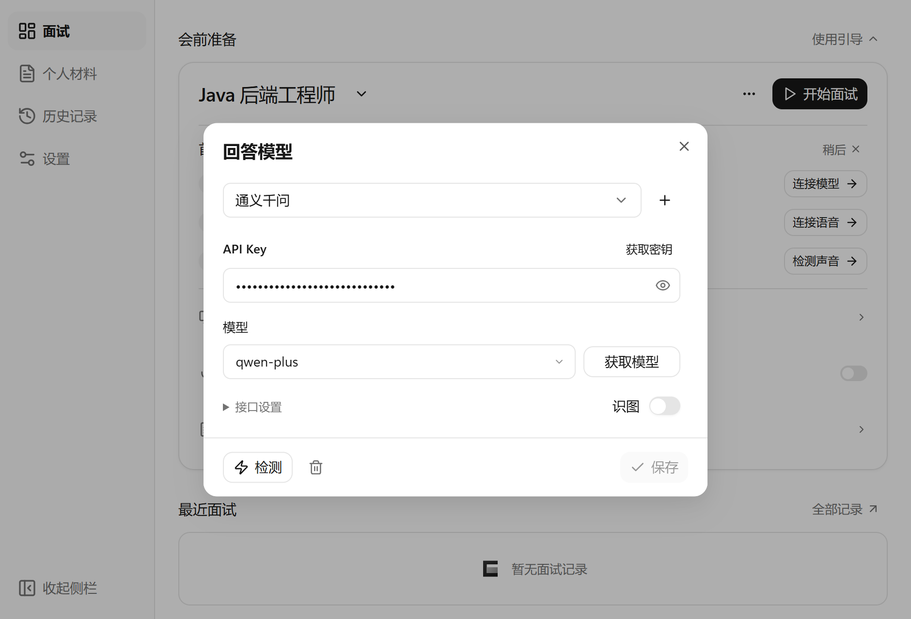
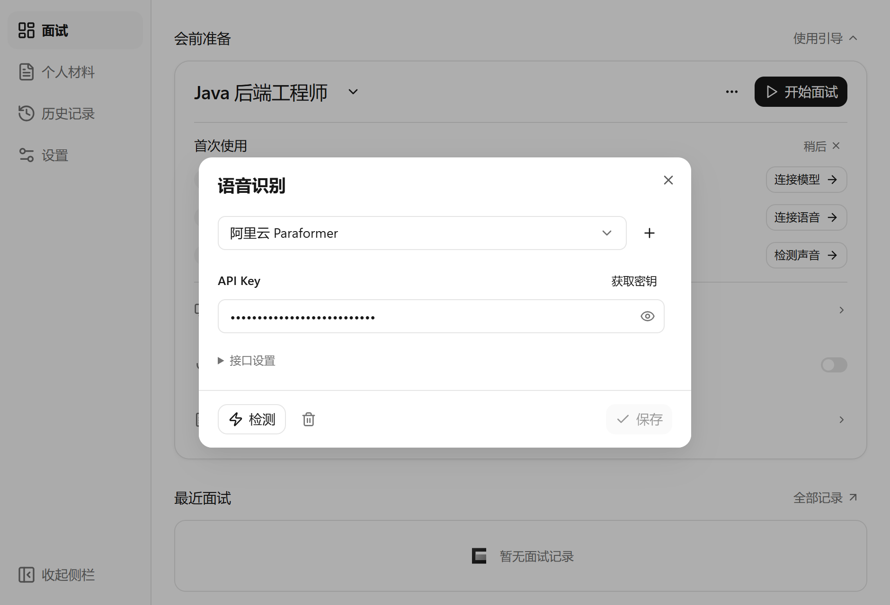
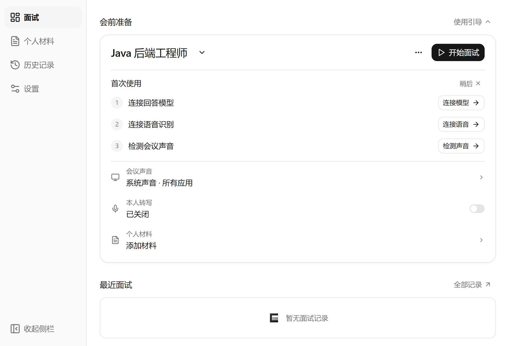

# 使用指南

[返回首页](../README.md) · [常见问题](FAQ.md) · [数据与隐私](PRIVACY.md)

## 1. 安装 Cuvilo

打开[最新正式版](https://github.com/Cuvilo/Cuvilo/releases/latest)，下载 `Cuvilo_<版本>_x64-setup.exe`，双击并按照提示安装。`.sig` 和 `latest.json` 由更新程序使用，不需要手动打开。

- 当前原生发行版面向 Windows x64，建议在 Windows 11 使用；macOS、Linux、Windows ARM64 暂无发行版。
- 指定应用声音采集要求 Windows build 20348 或以上，较旧系统请使用系统声音。最低兼容范围仍需随实际系统验证，不承诺所有 Windows 10 版本均可用。
- 界面需要 Microsoft Edge WebView2 Runtime。如果安装或启动提示缺少该组件，请从 [Microsoft 官方页面](https://developer.microsoft.com/microsoft-edge/webview2/)安装 Evergreen Runtime 后重试。
- 本地 Windows OCR 需要系统中相应的 OCR 语言组件；仅安装 Cuvilo 不会自动添加语言包。

## 2. 连接回答模型

首页点击“会前准备”右侧的“使用引导”，再点击“连接模型”。已有配置也可以从“设置 → 服务 → 回答模型”打开。

1. 选择自己的模型服务。例如使用百炼账号时选择“通义千问”，使用 DeepSeek 账号时选择“DeepSeek”。
2. 点击“获取密钥”前往官方控制台，创建并复制相应服务的 API Key，填入 Cuvilo。
3. 选择平台实际支持的模型；可以点击“获取模型”读取列表，也可以填写平台提供的模型标识。
4. 点击“检测”，连接成功后点击“保存”。

需要自定义渠道时，添加“兼容接口”，在“接口设置”填写显示名称和 Base URL。回答接口须兼容 Chat Completions，Base URL 和模型名称应与服务商文档一致。

“识图”开关决定截图是否直接交给该回答模型。最多一个模型可以开启；开启前确认所选具体模型支持图片输入，普通文字模型即使能回答文本，也不一定支持识图。

## 3. 连接语音识别

在首页引导中点击“连接语音”，或打开“设置 → 服务 → 语音识别”。

1. 选择已经开通的语音服务。
2. 填写界面要求的凭据。不同平台可能使用 API Key，也可能要求 App ID、Secret ID 或 Secret Key。
3. 点击“检测”，成功后点击“保存”。

使用阿里云时，回答模型和语音识别分别选择“通义千问”和“阿里云 Paraformer”。两处都要保存凭据；仅在密钥所属地区、工作空间和访问权限覆盖对应服务时才能复用同一个 Key。语音服务也需要已开通，不能用“模型连接成功”代替语音检测。[百炼密钥与地区说明](https://www.alibabacloud.com/help/en/model-studio/get-api-key)

“OpenAI”语音渠道面向兼容 Audio Transcriptions 的 HTTP 接口，按语音片段上传后识别，并非任意实时 WebSocket 协议的通用适配器。只修改地址不能使所有厂商互相兼容。

## 4. 选择并检测声音

1. 在首页“会议声音”中选择“系统声音”或正在播放声音的目标应用。
2. 播放一段测试声音，在引导中点击“检测声音”，根据检测结果确认音源。
3. 如果希望自己的发言也作为上下文，按需开启“本人转写”，并确认 Windows 允许访问麦克风。
4. 点击“开始面试”，在独立答案窗口查看问题与参考回答。

“系统声音”会包含其他应用正在播放的声音；只需要某个应用时，优先选择对应音源。指定应用可能在开始播放后才出现在列表中。首次可用合成问题或自己的练习材料验证完整流程。

## 5. 添加个人材料

打开“个人材料”，选择分类后导入文件、拖入文件或新建文字材料。

- **我的经历**：放简历、项目经历等已确认的个人事实，用于回答时参考。
- **知识资料**：放技术笔记、复习资料等内容，按问题进行本地关键词检索，使用相关片段。
- 导入支持 PDF、DOCX、UTF-8 TXT 和 Markdown。导入前检查预览文字；纯图片或扫描 PDF 如果没有可提取文字，可先自行 OCR 后导入文本。
- 在分类“知识资料”下导入或拖入，默认创建知识资料。按需启停材料，避免无关内容影响回答。

## 6. 截图、手动提问与阅读

- **截图提问**：默认 `Ctrl+Shift+S`，框选题目。
- **手动提问**：默认 `Ctrl+Shift+M`，输入或修改问题。
- **立即回答**：默认 `Ctrl+Enter`。
- **停止回答**：默认 `Ctrl+Shift+X`。
- **显示/收起答案窗口**：默认 `Ctrl+Shift+H`。

快捷键可在“设置 → 快捷键”修改或停用。答案中的每段代码均有独立复制入口；阅读菜单可以调整字号、生成字数和背景透明度，背景透明度支持 0–80%。生成字数是目标提示，实际长度由所选模型决定。

截图路由：开启识图时优先交给该模型；未开启或识图失败时，通过“设置 → 服务 → 截图识别”中选择的 OCR 服务提取文字，再由对话模型作答。云端识图/OCR 会上传所选图片，本地 Windows OCR 不上传图片；后续云端回答仍会发送所需文本。

## 7. 更新与备份

有更高正式版本时，标题栏显示“下载更新”，下载并验证签名后变为“重启更新”。也可以在“设置 → 关于”检查更新；托盘出现新版版本号时，点击即可下载并安装。面试中会延后更新，未保存的编辑需要先保存或取消。

在“设置 → 数据”创建数据备份，可恢复材料和文字面试记录。此导出不包含服务配置或 API Key；更换电脑后仍需重新配置服务。恢复会替换现有材料和记录，先阅读恢复预览。

## 服务与官方入口

| 服务 | 用途 | 官方入口 |
| --- | --- | --- |
| 阿里云百炼 | 回答模型、Paraformer 语音 | [控制台 API Key](https://bailian.console.aliyun.com/cn-beijing/model/settings/api-key) |
| DeepSeek | 回答模型 | [API Key 控制台](https://platform.deepseek.com/api_keys) |
| 硅基流动 | 回答模型、视觉模型 | [API Key 控制台](https://cloud.siliconflow.cn/account/ak) |
| 讯飞 RTasr | 实时语音识别 | [官方接口说明](https://www.xfyun.cn/doc/asr/rtasr/API.html) |
| 腾讯云 | 实时语音识别 | [访问密钥控制台](https://console.cloud.tencent.com/cam/capi) |
| 火山引擎 | 豆包语音 | [语音控制台](https://console.volcengine.com/speech/new/setting/apikeys?projectName=default) |
| OpenAI | Audio Transcriptions 语音 | [API Key 控制台](https://platform.openai.com/api-keys) |

Cuvilo 不提供第三方服务额度。服务型号、开通方式、地区、计费及免费额度可能变化，以官方控制台为准。更换模型后请重新检测实际使用能力。
